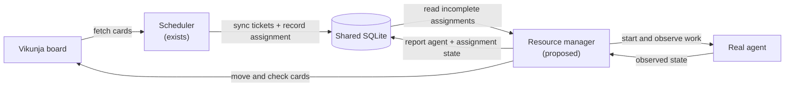
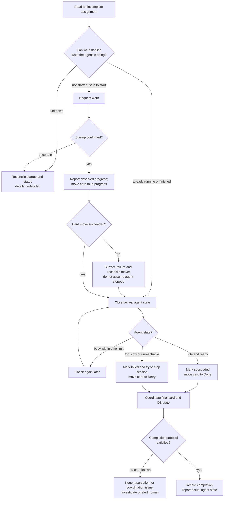
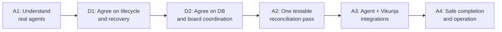

# Agent resource manager: proposed flow

Estimated reading time: 1 minute (150 WPM)

**This is a proposed direction, not implemented behavior.** See the [proposal](proposal.md) for the build slices, safety boundaries, and open decisions.

## Big picture

SQLite is the shared job board. An assignment reserves work; it does not prove that the agent started.

## One assignment: proposed path

**Important:** The completion protocol is not designed yet. A stale scheduler fetch can overwrite a newer card status, so a successful move alone does not make release safe. Startup and card-move ordering are also undecided.

## Build path

Each box is a proposed milestone, not a commitment to implement it now.
