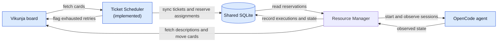
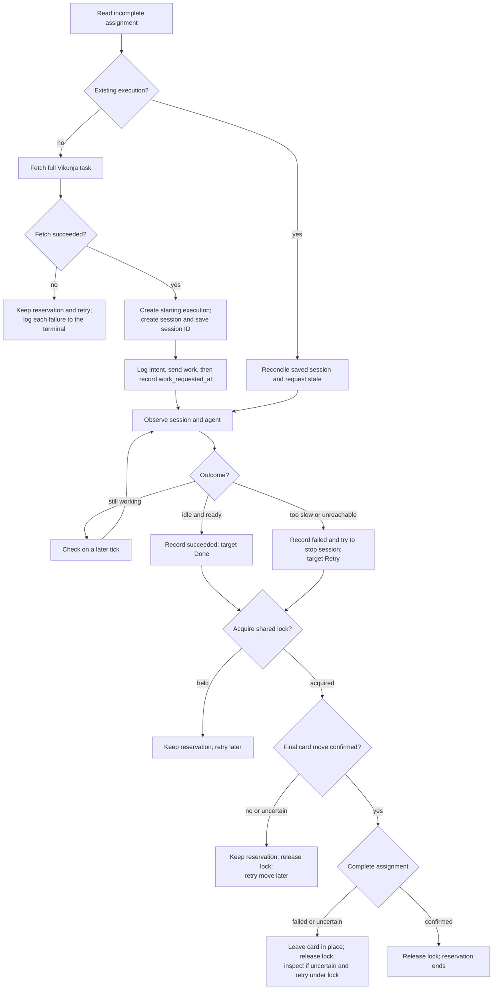
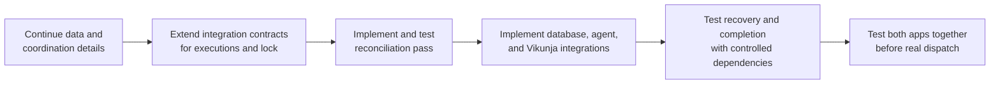

# Agent resource manager: proposed flow

Estimated reading time: 2 minutes (150 WPM)

The core Ticket Scheduler and Resource Manager paths below are implemented and tested with controlled dependencies. Deployed APIs and some readiness behavior still need verification. See the [data design](data.md) for recovery and coordination details.

## Big picture

Blue boxes are outside the Resource Manager app.

SQLite is the shared job board. An incomplete assignment reserves its ticket and agent; it does not prove work started. Both apps use the same `ticket-scheduling` lock for coordinated completion.

## One assignment: proposed path

The manager polls every agent each tick. A failed task fetch does not count as an agent attempt. The manager flags unreachable agents unavailable for human review. When it observes a session busy, it records progress and moves the card to `In progress`; failed moves are retried while the session remains busy. A failed attempt can be retried even if stopping the old session cannot be confirmed. The Ticket Scheduler checks recorded attempts on `Retry` tickets and flags exhausted work instead of assigning it.

The shared lock covers the final move and assignment completion. Both apps must use it and Vikunja reads must reflect confirmed moves. Potentially stale locks require human review, not automatic removal. See the [data design](data.md) for the agreed restart cases and failure handling.

## Build path

These describe the build path; controlled tests now cover the core integration. The shared tables need external setup; the [shared seed](../../shared-db/seed.sql) creates them for a new database, but a human must populate and validate agent rows. Do not start live agents without authorization.
