# Agent resource manager: initial sequence diagram

Estimated reading time: 3 minutes (150 WPM)

The core flow is implemented and tested with controlled dependencies. Deployed API compatibility and some readiness behavior still need verification or decisions. This diagram omits some restart cases; see the [data design](data.md).

## One assignment

```mermaid
sequenceDiagram
    autonumber
    box rgb(30,58,138)
        participant V as Vikunja
        participant S as Ticket Scheduler
        participant DB as Shared SQLite
    end
    participant RM as Resource manager
    box rgb(30,58,138)
        participant A as OpenCode agent
        participant H as Human monitor
    end

    loop Each Resource Manager tick for every agent
        RM->>A: Check agent status
        A-->>RM: Observed status or unreachable
        opt Agent is unreachable
            RM->>DB: Set status to needs_review
        end
    end

    S->>DB: Try to acquire ticket-scheduling lock
    alt Lock already held
        Note over S: Skip this pass and retry later
    else Lock acquired
        S->>V: Fetch board tickets
        V-->>S: Tickets and column statuses
        S->>DB: Sync tickets and find eligible work
        opt Eligible ticket is in Retry
            S->>DB: Count recorded work requests for ticket
            DB-->>S: Attempt count
        end
        alt Retry at attempt limit
            S->>V: Move card to Flagged tickets
            Note over S,H: Human intervention<br/>No assignment is created
        else Eligible work and idle agent available
            S->>DB: Reserve ticket and agent with an assignment
        end
        S->>DB: Release lock using owner token
    end

    Note over DB: Incomplete assignment reserves ticket and agent<br/>It does not prove work started
    Note over RM: Reconcile each reserved assignment
    RM->>DB: Read incomplete assignment, ticket, and agent
    alt New work with no existing execution
        RM->>V: Fetch task by vikunja_task_id
        alt Task fetch fails
            V-->>RM: Fetch failure
            Note over RM,DB: Keep reservation and retry later<br/>Do not count an agent attempt
            RM->>H: Log each fetch failure to the terminal
        else Task fetch succeeds
            V-->>RM: Task details, including description
            RM->>DB: Create starting execution
            RM->>A: Create session
            A-->>RM: Session ID
            RM->>DB: Save session ID
            Note over RM: Log execution and session IDs before sending<br/>Logging details are deferred
            RM->>A: Send work request
            RM->>DB: Record work_requested_at after sending
            Note over RM,DB: A recorded request counts as one attempt<br/>A sent but unrecorded request does not
        end
    else Existing execution or restart
        RM->>A: Inspect known session and reconcile request state
        A-->>RM: Observed state, missing, or unreachable
        Note over RM,DB: Recovery depends on saved session ID and work_requested_at<br/>See data design for agreed cases
    end

    opt Startup confirmed
        Note over RM,V: Observed busy confirms startup<br/>Failed moves are retried while busy
        RM->>DB: Report observed agent and assignment progress
        RM->>V: Move card to In progress
        alt Move fails
            RM->>H: Surface or reconcile the failed move
            Note over RM,A: A failed card move does not mean work stopped
        end
    end

    opt An execution reaches an outcome
        alt Agent stopped processing and is ready
            RM->>DB: Record succeeded
            Note over RM: Target column is Done<br/>Ticket results are not verified
        else Too slow, unreachable, or confirmed missing session after recorded request
            RM->>DB: Record failed
            RM->>A: Try to stop the session when applicable
            Note over RM,A: Target column is Retry<br/>Retry may proceed even if stop is unconfirmed
        end
        RM->>DB: Try to acquire ticket-scheduling lock
        alt Lock already held
            Note over RM,DB: Keep reservation and retry later
        else Lock acquired
            RM->>V: Move card to Done or Retry
            alt Move failed or result uncertain
                Note over RM,DB: Keep reservation and retry move later
            else Move confirmed
                RM->>DB: Complete assignment
                alt Completion failed or result uncertain
                    Note over RM,DB: Leave card in place<br/>Inspect uncertain result and retry completion under lock
                else Completion confirmed
                    Note over DB: Reservation ends
                end
            end
            RM->>DB: Release lock using owner token
        end
    end

    opt Later Ticket Scheduler pass finds an eligible Retry ticket
        Note over S,DB: The scheduler holds ticket-scheduling lock<br/>across this fetch and scheduling pass
        S->>DB: Check recorded attempt count
        Note over S,DB: First recorded attempt counts as 1<br/>Default limit is 3 and is configurable
        alt Below attempt limit
            S->>DB: Reserve a new assignment on an available agent
        else Attempt limit reached
            S->>V: Move card to Flagged tickets
            Note over V,H: Human intervention
        end
    end
```

Dark blue groups are outside the Resource Manager app. Interactions are logical, not a promise that every action occurs in one pass. Retries, restarts, and failures may span multiple passes. The shared tables and agent URL must be set up externally; their presence is not guaranteed.

## Discussed: directions to implement

- Fetch the full Vikunja description before starting work. If the fetch fails, keep the assignment reserved, retry, and log each failure to the terminal.
- Poll every agent each tick. The Resource Manager decides the outcome: idle and ready means success; too slow or unreachable means failure.
- On failure, try to stop the session, but allow a retry even if the stop cannot be confirmed. Flag unreachable agents for human review and use another available agent.
- The Ticket Scheduler checks the attempt limit and moves exhausted tickets to `Flagged tickets`. The first attempt counts as 1.
- Use a shared database lock: the Ticket Scheduler holds it across board fetch, sync, and scheduling; the Resource Manager holds it across the final card move and assignment completion. Flag potentially stale locks for human review, rather than clearing them automatically.
- Assume humans do not manually move cards. No special Resource Manager behavior for manual moves is needed; the user expects the Ticket Scheduler to flag data inconsistencies appropriately.

## Values and details to work out

- Agent timeout value. The timeout is configurable but disabled by default. The Ticket Scheduler's attempt limit defaults to 3 and is configurable.
- Locks held for more than two minutes are logged for human review, not removed automatically. Human recovery steps remain to be documented.
- Verify session identification and readiness against the deployed OpenCode API. Fast tasks can be recognized from a newer completed busy/idle interval; if timestamps are absent or do not advance, the assignment can remain reserved until restart or configured timeout.
- Coordination with other controllers and how humans clear agent or ticket flags. The shared lock and key failure handling are implemented; the manager also uses a pass lock that requires human review if left behind by a crash.

These are discussed topics, not necessarily new questions for the user. Work through implementation details as we build, and revisit deferred decisions when needed.

## Open: not yet discussed

No undiscussed topics are currently listed.

See the [proposal](proposal.md), [flowchart](flowchart.md), and [session context](session-context.md) for background. The Ticket Scheduler's [shared data reference](../../scheduler/docs/shared-data.md) records the agreed responsibility split and retry rules.
