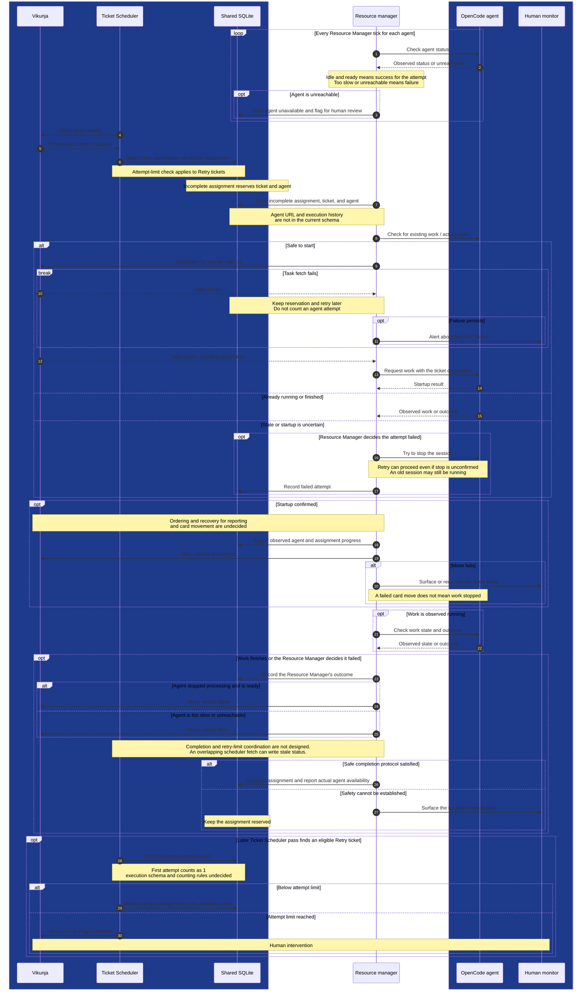

# Agent resource manager: initial sequence diagram

Estimated reading time: 3 minutes (150 WPM)

**Draft:** This is a proposed flow, not implemented behavior or an approved lifecycle. It will change as we resolve the open questions.

## One assignment

Dark blue groups are outside the Resource Manager app. The diagram shows logical interactions, not a promise that every action occurs in one pass. Retries, restarts, and failures may span multiple passes.

## Discussed: directions to implement

- Fetch the full Vikunja description before starting work. If the fetch fails, keep the assignment reserved, retry, and alert a human if the failure persists.
- Poll every agent each tick. The Resource Manager decides the outcome: idle and ready means success; too slow or unreachable means failure.
- On failure, try to stop the session, but allow a retry even if the stop cannot be confirmed. Flag unreachable agents for human review and use another available agent.
- The Ticket Scheduler checks the attempt limit and moves exhausted tickets to `Flagged tickets`. The first attempt counts as 1.
- Use a shared database lock to coordinate scheduler passes and assignment completion. Flag potentially stale locks for human review, rather than clearing them automatically.
- Assume humans do not manually move cards. No special Resource Manager behavior for manual moves is needed; the user expects the Ticket Scheduler to flag data inconsistencies appropriately.

## Values and details to work out

- Agent timeout, attempt limit, and when persistent task-fetch failures trigger an alert.
- Stale-lock warning threshold and human recovery steps, explicitly deferred for later.
- Execution-record fields, session identification, startup and restart recovery, and readiness detection for the correct execution.
- Lock protocol and coordination with other controllers, card-move failures, and how humans clear agent or ticket flags.

These are discussed topics, not necessarily new questions for the user. Work through implementation details as we build, and revisit deferred decisions when needed.

## Open: not yet discussed

No undiscussed topics are currently listed.

See the [proposal](proposal.md), [flowchart](flowchart.md), and [session context](session-context.md) for background. The [Ticket Scheduler change handoff](../../scheduler/docs/retry-limit-handoff.md) describes the agreed responsibility split.
