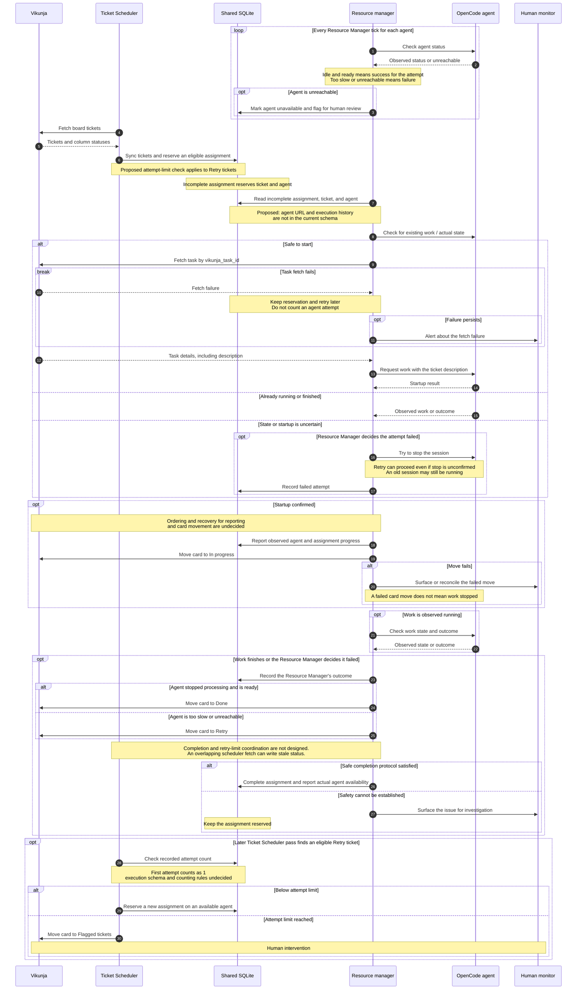

# Agent resource manager: initial sequence diagram

Estimated reading time: 2 minutes (150 WPM)

**Draft:** This is a proposed flow, not implemented behavior or an approved lifecycle. It will change as we resolve the open questions.

## One assignment

The diagram shows logical interactions, not a promise that every action occurs in one pass. Retries, restarts, and failures may span multiple passes.

## Questions to resolve

- What else belongs in the work payload? When should a persistent task-fetch failure trigger an alert?
- How does the manager identify existing OpenCode sessions and recover after an uncertain start or restart?
- How do we recognize startup and readiness for the correct execution? How do we prevent competing controllers from dispatching work?
- What does an execution record contain, and which statuses and transitions do we want?
- What is the attempt limit, how are attempts identified in execution records, and how should a flagged ticket be handled? How do we prevent further retries at the limit?
- How long is too long, and how is the timeout measured? What happens if no replacement agent is available?
- How should card-move failures and manual card changes be handled?
- How do we enforce one active manager and safely complete assignments despite overlapping scheduler fetches?

See the [proposal](proposal.md), [flowchart](flowchart.md), and [session context](session-context.md) for background. The [Ticket Scheduler change handoff](../../scheduler/docs/retry-limit-handoff.md) describes the agreed responsibility split.
