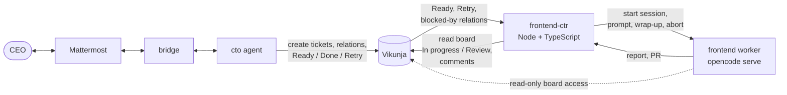
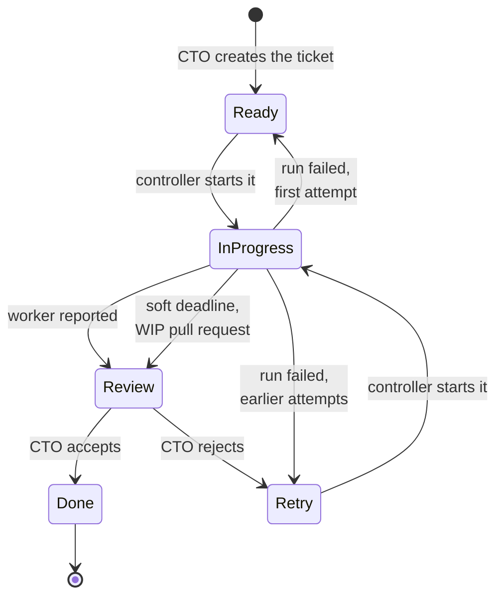
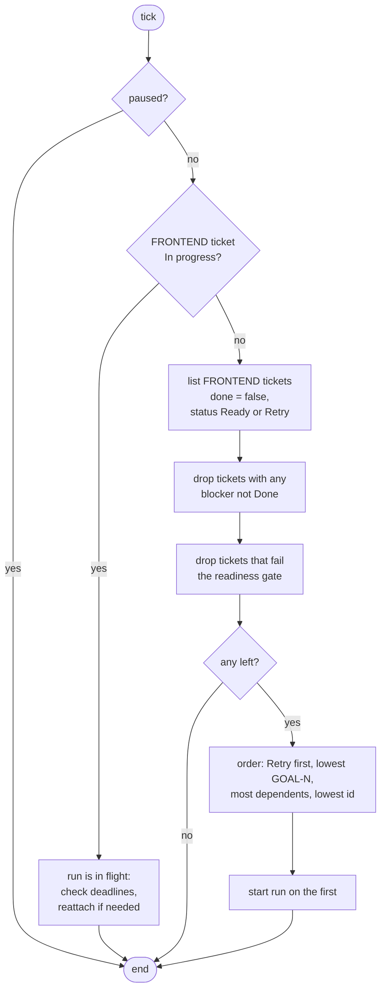
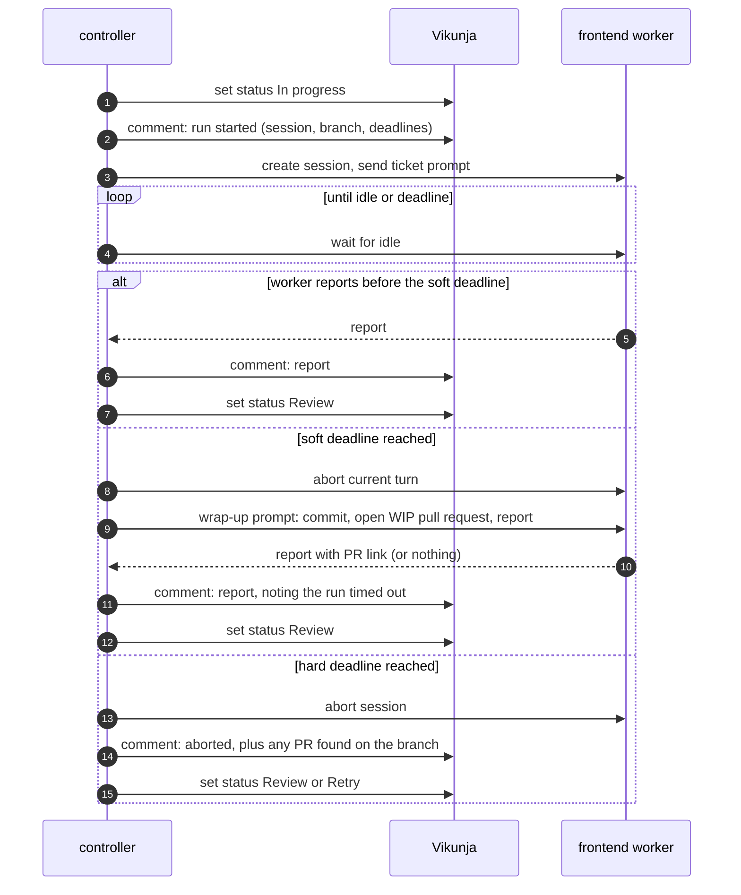

# Frontend controller proposal

A small TypeScript Node server that feeds the **frontend** worker with the next workable ticket from Vikunja. It replaces the tech lead for this one worker. Other workers get their own controllers later, once this direction is proven.

## 1. Goal and non-goals

**Goal.** Keep the frontend worker busy with exactly one ticket at a time, always the next one its Vikunja dependencies allow. If the worker is busy, the other tickets wait in the queue.

**Non-goals.**

- No planning, no re-scoping, no judging results. The CTO does those.
- No new tracking scheme. Everything the controller needs already exists in Vikunja: task relations, Kanban status, and the `GOAL-N` label.
- No LLM in the controller. Selection and scheduling are deterministic code.
- No backend or aws-solutions-architect support. The worker-specific settings are isolated in one config module so a sibling controller is a copy, not a rewrite.

## 2. Where it sits



Ownership is split so that no two parties move the same status:

| Who | Moves a ticket to |
| --- | --- |
| CTO | Ready, Done, Retry |
| Controller | In progress, Review |
| Frontend worker | nothing. It may comment on its own ticket |

## 3. Ticket model (what the controller relies on)

This is the CTO's output as defined in [cto.md](../agents/cto.md).

| Concept | Vikunja feature |
| --- | --- |
| Sprint | label `GOAL-N` (the only label anyone adds) |
| Dependencies | task relation: ticket is `blocked` by #x, #y |
| Status | Kanban bucket: Ready, In progress, Review, Retry, Done |
| Frontend work | project FRONTEND |
| Time budget | due date, with a default when missing |



A dependency is satisfied only when its blocker is **Done**. A blocker in Review still blocks, because the CTO has not accepted it yet.

## 4. State: the controller is stateless

The controller keeps nothing on disk. Everything it needs can be read back:

| Question | Where the answer lives |
| --- | --- |
| Is the frontend worker busy? | a FRONTEND ticket is In progress |
| What is it working on, and in which session? | a marker comment the controller wrote on that ticket |
| When does it have to stop? | the marker comment (soft and hard deadline timestamps) |
| Is the session still alive? | the frontend opencode server |
| How many attempts so far? | count of the controller's marker comments on the ticket |

Marker comment, written when a run starts and always parseable:

```
[frontend-ctr] run started
session: ses_abc123
branch: ticket-42-login-form
soft_deadline: 2026-11-02T10:24:00Z
hard_deadline: 2026-11-02T10:30:00Z
```

Because "busy" is derived from the board, restarting the controller (or running it twice by mistake) cannot lose or duplicate work. A single in-process mutex stops two ticks from overlapping inside one process.

## 5. The loop

A tick runs every `CTR_POLL_MS` (default 30 s). One tick at most starts one run. While a run is in flight, ticks only watch the deadline.



**Readiness gate.** A deterministic check, so a bad ticket never reaches the worker: the description has acceptance criteria, and `dueDate` is set or the default budget applies. A ticket that fails the gate gets one comment saying what is missing, is skipped, and appears under "skipped" in `/status`. The CTO fixes it. The controller never edits requirements.

**Ordering.** Retries first, because a rejected ticket has the most sunk cost. Then the lowest `GOAL-N`, so sprints do not mix. Then the ticket that unblocks the most others (count of its `blocking` relations). Then the lowest ticket id for a stable tie-break.

## 6. A run



### The prompt the controller builds

The worker works only from the prompt, so the controller assembles it from the board:

1. Ticket id, title, description (which already carries the author's goal, threshold, acceptance criteria and API contract).
2. For each blocker that is Done: its title and the worker's report from its comments, so the worker gets file paths, routes, ports and env var names.
3. The deadline, soft and hard, as clock times.
4. The branch to use: `ticket-<id>-<slug>`.
5. The report format (files modified, tests executed, results, skipped tests, blockers, anything left undone) and the honesty reminder: do not claim a test passed unless it ran.

### Deadlines

| | When | What happens |
| --- | --- | --- |
| Budget | `dueDate - now`, capped by `CTR_MAX_RUN_MIN`; `CTR_DEFAULT_BUDGET_MIN` when no due date | start of the run |
| Soft deadline | 80% of the budget | the current turn is aborted and the wrap-up prompt is sent. The worker commits what it has, opens a `WIP:` pull request, and reports what is done and what is left |
| Hard deadline | 100% plus `CTR_GRACE_MIN` (default 5) | the session is aborted. The controller looks for a pull request on the branch and comments with what it finds |

The wrap-up goes in as a new message after an abort rather than as a queued message, because a queued message would wait until the worker's current turn ends, which may be after the deadline.

A ticket that hit a deadline goes to **Review** with the PR link in its comments. The CTO decides whether the partial work meets the threshold or goes to Retry. The controller adds no label for this. The comment says "timed out".

## 7. Failures and restarts

| Situation | Controller action |
| --- | --- |
| Controller restarts while a ticket is In progress | Read the marker comment. Session still running: reattach and keep watching. Session idle with a report: harvest it. Session gone: treat as a failed run |
| opencode server unreachable at start | Do nothing, status unchanged, retry next tick |
| Run fails (session lost, API error, empty report) | Comment with the error. Status back to Ready on the first attempt, Retry after that |
| Same ticket fails 3 times | Skip it, report it under "skipped" in `/status`, and leave a comment for the CTO. No endless loop |
| Vikunja write fails (the plugin already saw HTTP 500 on concurrent writes) | Writes are serial, retried once, then logged. A failed status move after a finished run is retried on the next tick; the report comment is written first so nothing is lost |
| Two controllers by mistake | The second sees the ticket In progress and does nothing |

## 8. Project layout

```
apps/frontend-ctr/
  package.json          express, typescript, vitest
  tsconfig.json
  Dockerfile            builds to dist/, runs node dist/index.js
  src/
    index.ts            HTTP server, starts the loop
    config.ts           env vars; the only worker-specific module
    vikunja.ts          REST client: tasks, relations, status, comments
    opencode.ts         REST client: session, prompt, wait, abort, messages
    select.ts           pure: pick the next ticket from board data
    prompt.ts           pure: build the worker and wrap-up prompts
    run.ts              lifecycle: start, watch, wrap up, abort, finish
    reconcile.ts        rebuild the in-flight run from the board after a restart
  test/
    select.test.ts      dependency, ordering and gate cases
    prompt.test.ts
```

`select.ts` and `prompt.ts` take plain data and return plain data, so the scheduling rules are unit-tested without Vikunja or opencode.

**HTTP surface** (bound to `127.0.0.1`, for operating it):

| Route | Purpose |
| --- | --- |
| `GET /health` | liveness, for the compose healthcheck |
| `GET /status` | current run and deadlines, ordered queue, tickets skipped and why |
| `POST /pause`, `POST /resume` | stop starting new runs without touching the one in flight. In memory only, so a restart resumes |
| `POST /tick` | run one tick now, for debugging |

**Config** (all env vars, loaded from `.env.local` like the other services):

`VIKUNJA_URL`, `VIKUNJA_API_TOKEN`, `FRONTEND_URL` (default `http://opencode-frontend:4096`), `CTR_PROJECT_ID`, `CTR_POLL_MS`, `CTR_DEFAULT_BUDGET_MIN`, `CTR_MAX_RUN_MIN`, `CTR_GRACE_MIN`.

**Compose.** A new `frontend-ctr` service on the `shared` network, `depends_on: frontend`, port `127.0.0.1:3200:3000`, with a healthcheck like the bridge's.

## 9. What has to change outside the controller

1. **vikunja plugin and the CTO's tools.** Add `add_relations`, `set_status`, status in `list_tasks`, and relations and status in `get_task`. Make `set_goal` produce `GOAL-N`. This is the work already listed after the cto.md rewrite.
2. **frontend.md.** It says "the tech lead and the CTO own the ticket states". Change that to "the controller and the CTO". Add the wrap-up behaviour: when told time is nearly up, stop new work, commit, open a `WIP:` pull request, and report done and left. Make the branch name rule explicit.
3. **Existing board.** Tickets already on the board use the old labels. Either migrate them once or start the new scheme on a fresh goal.
4. **Cleanup.** `tools/assign.ts`, `ASSIGN_TIMEOUT_MS` and `workspace/team/capabilities.md` are now unused. Remove them once the controller works. [dev-process.md](dev-process.md) still describes the tech lead.

## 10. Assumptions to verify before building

These come from reading the repo, not from running anything.

| Assumption | Why it matters |
| --- | --- |
| The frontend opencode server has the v2 API the bridge uses (`/api/session`, `/prompt`, `/experimental/session/:id/wait`, `/message`). `tools/assign.ts` uses the older `/session` and `/message` routes. | Decides the opencode client |
| There is an abort route for a session or a running turn. | The deadline design depends on it |
| After an abort, the same session accepts another prompt and keeps its context. | The wrap-up needs the worker's context |
| Vikunja's task payload includes `related_tasks` (blocked, blocking) and the Kanban bucket. | Selection reads both |
| The Kanban view of FRONTEND can be given the five columns, with Done as the done bucket, and moving a task through the API works on your Vikunja version. | The whole status model |
| The frontend container's `gh` token can push a branch and open a PR in the target repo. | The wrap-up |

I would check all six against the running stack as the first build step, before writing the controller.

## 11. Open questions

1. **Budget source.** Ticket due dates are the sprint deadline, which may be days away. Is `CTR_MAX_RUN_MIN` (say 60) the right cap on one run, with the due date only deciding when a ticket is too late to start?
2. **Late tickets.** If the due date has already passed, start it anyway with the default budget, or skip it and tell the CTO?
3. **Review is an extra status.** The statuses you listed were Ready, Retry, In progress and Done. The design needs Review so finished work can wait for the CTO. Confirm.
4. **Repository.** Which repository does the frontend worker open PRs in: one fixed repo, or named in the ticket?

## 12. Build order

1. Verify the assumptions in section 10 against the running stack.
2. Update the vikunja plugin and configure the FRONTEND Kanban view.
3. Write `select.ts` and `prompt.ts` with tests (no I/O).
4. Write the Vikunja and opencode clients, then `run.ts` and `reconcile.ts`.
5. Dry-run mode: the controller logs which ticket it would start but does not start it. Run it against a real board.
6. Enable it for one ticket, then a chain of dependent tickets, then a forced deadline.
7. Update `frontend.md`, remove the leftover tech-lead files, and update `dev-process.md`.
