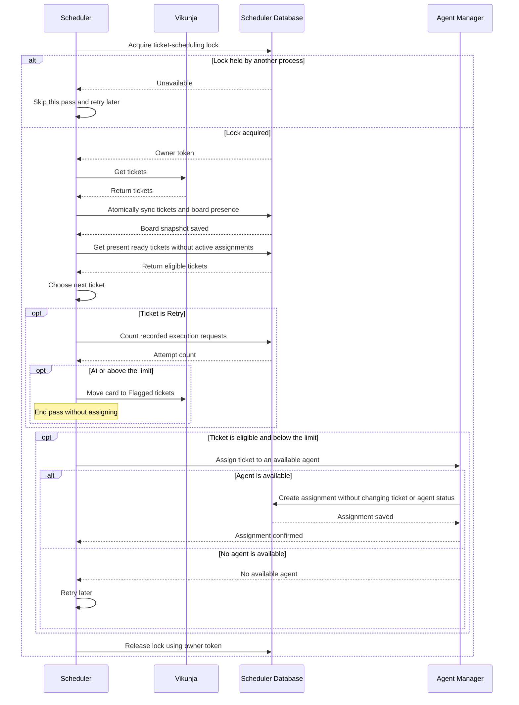

# Communication

Estimated reading time: 1 minute (150 WPM)

The lock is also released after pass errors. A failed or uncertain move is retried after a fresh board fetch. The Resource Manager has not implemented its side of the lock protocol yet.
