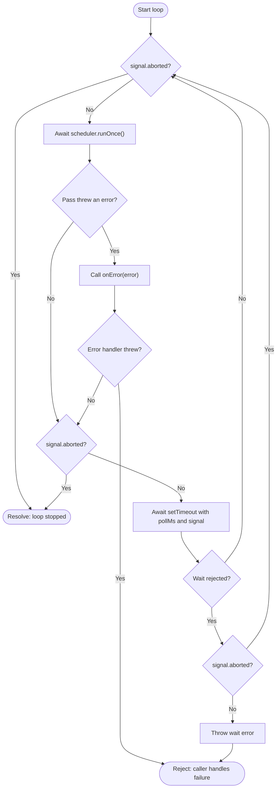

# Scheduler loop: decisions and line-by-line walkthrough

Estimated reading time: 6 minutes (150 WPM)

Source: [`src/scheduler-loop.ts`](../src/scheduler-loop.ts).

## Mental model

Like checking a game lobby for a match: check, finish that check, wait, check again. Never start a second check while the first is still running.

The loop controls **when** scheduling happens. `Scheduler.runOnce()` controls **which ticket** to try assigning. No tickets or no available agent still means waiting before the next pass.

## Decision flow



- **Already stopped:** no pass starts.
- **Pass succeeds or fails:** wait before the next pass, unless shutdown was requested.
- **Shutdown during a pass:** finish that pass, then stop. The loop does not cancel `runOnce()`.
- **Shutdown during the wait:** cancel the timer, then exit through the next `while` check.
- **Unexpected wait failure:** reject the loop instead of quietly retrying.
- **Error handler failure:** also rejects the loop. The default handler just logs.

In `index.ts`, a rejected loop is logged and triggers application shutdown. Ordinary pass failures are handled inside the loop and do not shut down the app.

## Loop snippet

This is the current source, without its opening file comment. The numbers in the next section refer to the actual source-file lines, not added code.

```ts
import { setTimeout } from "node:timers/promises"
import type { SchedulerInterface } from "./interfaces/scheduler.interface.js"

export async function runSchedulerLoop(
  scheduler: SchedulerInterface,
  pollMs: number,
  signal: AbortSignal,
  onError: (error: unknown) => void = (error) => console.error("scheduler pass failed:", error),
): Promise<void> {
  while (!signal.aborted) {
    try {
      await scheduler.runOnce()
    } catch (error) {
      onError(error)
    }

    if (signal.aborted) {
      return
    }

    try {
      // Wait after each pass, whether it succeeded, failed, or found no work.
      await setTimeout(pollMs, undefined, { signal })
    } catch (error) {
      if (!signal.aborted) {
        throw error
      }
    }
  }
}
```

## What each line does

| Source line | Code | Meaning |
| --- | --- | --- |
| 1 | Opening comment | Describes the goal: repeat passes without overlap. |
| 2 | `import { setTimeout } ...` | Imports the promise-based timer, so the wait can be awaited. Not the callback-based global timer. |
| 3 | `import type ...` | Imports the scheduler's TypeScript contract. No runtime code is loaded by this type-only import. |
| 5 | `export async function runSchedulerLoop(` | Makes the loop callable from other files. An async function returns a promise. |
| 6 | `scheduler: SchedulerInterface` | Receives the object whose `runOnce()` method performs one pass. Tests supply a fake scheduler. |
| 7 | `pollMs: number` | Receives the delay in milliseconds after each finished pass. |
| 8 | `signal: AbortSignal` | Receives the stop signal, like a shared stop button. |
| 9 | `onError: ...` | Receives a pass-error handler. Defaults to logging. `unknown` means the thrown value is not assumed to be an `Error`. |
| 10 | `): Promise<void> {` | The returned promise resolves when the loop stops normally, with no result value. Unhandled failures reject it. |
| 11 | `while (!signal.aborted) {` | Starts another iteration only while nobody has requested shutdown. |
| 12 | `try {` | Starts the protected scheduling section. |
| 13 | `await scheduler.runOnce()` | Runs one pass and waits for it to finish. This prevents overlapping passes in this loop invocation. |
| 14 | `} catch (error) {` | Catches a thrown error or rejected promise from the pass. |
| 15 | `onError(error)` | Reports that failure. Does not retry immediately. If this handler itself throws, the loop rejects. |
| 16 | `}` | Ends the pass-error handler. |
| 18 | `if (signal.aborted) {` | Checks whether shutdown was requested while the pass was running. |
| 19 | `return` | Stops immediately without starting a polling wait. |
| 20 | `}` | Ends the post-pass stop check. |
| 22 | `try {` | Starts a separate protected section for the polling wait. |
| 23 | Wait comment | Explains that success, failure, and no work all use the same delay. |
| 24 | `await setTimeout(pollMs, undefined, { signal })` | Waits for the delay. `undefined` is the unused resolved value; `{ signal }` lets shutdown cancel the wait. |
| 25 | `} catch (error) {` | Handles cancellation or another timer failure. |
| 26 | `if (!signal.aborted) {` | Checks whether this failure happened without a shutdown request. |
| 27 | `throw error` | Unexpected timer failure: reject the loop so the caller can respond. |
| 28 | `}` | Ends the unexpected-failure check. |
| 29 | `}` | Ends the wait handler. During shutdown, the error is swallowed intentionally. |
| 30 | `}` | Ends the iteration. Go back to line 11 and check the stop signal again. |
| 31 | `}` | Ends the function. Exiting the `while` loop resolves its promise. |

Blank lines separate the three sections: run a pass, check shutdown, wait.

## Stepping through the first loop test

Open [`test/scheduler-loop.test.ts`](../test/scheduler-loop.test.ts) and choose **Scheduler: debug loop tests** in VS Code.

Set breakpoints at the fake `runOnce()` and source lines **13**, **15**, and **24**.

1. First pass: the fake scheduler throws. Line 15 records the error, then line 24 waits.
2. Second pass: the fake scheduler succeeds. The loop waits again.
3. Third pass: the fake scheduler calls `controller.abort()`. Line 18 detects shutdown and line 19 returns without another wait.

The fake scheduler's `await setImmediate()` yields to Node's event loop before continuing. That gives asynchronous work a turn; it is not the polling delay.

The test's `running` flag checks that each pass finishes before another begins. Its `calls` counter should finish at three.
