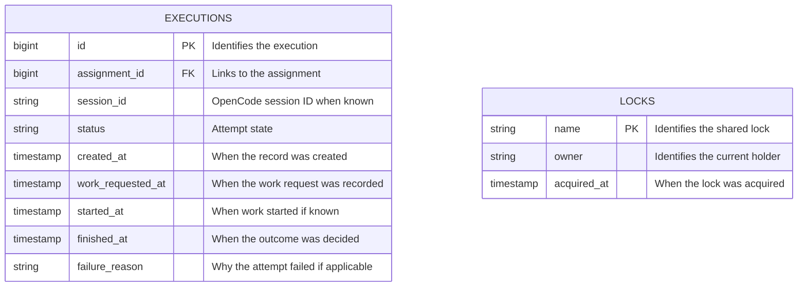

# Shared data reference

Estimated reading time: 4 minutes (150 WPM)

This is a scheduler-side copy of the approved models in the [Resource Manager data design](../../agent-resource-manager/docs/data.md). Both apps are intended to use the same SQLite database and shared tables. Someone must set up the database; the Ticket Scheduler does not create or migrate tables at startup. A separate manual seed can create the shared tables. See [setup](setup.md).

The existing database may not yet contain these tables or the planned agent URL. The models below are a design reference, not evidence that the database is ready. The seed script defines SQLite types for the execution and lock tables; it does not add the agent URL.

## Executions and locks

- `session_id`, `work_requested_at`, `started_at`, `finished_at`, and `failure_reason` can be empty.
- Execution statuses: `starting`, `running`, `succeeded`, and `failed`.
- An execution links to an assignment, which links to its ticket and agent. Count an attempt only when `work_requested_at` is recorded. The first attempt counts as 1.
- The planned agent data keeps numeric `agents.id` and adds the OpenCode server URL. The scheduler relies on the agent status stored in the table.
- A lock is acquired by atomically inserting its unique name and owner token, and released only when both match. The scheduler uses the name `ticket-scheduling`; the Resource Manager must use the same name and protocol. A held lock means retry on a later tick. Potentially stale locks are left for human review.
- The scheduler holds the lock across board fetch, sync, and scheduling. The agreed Resource Manager direction is to hold the same lock across the final card move and assignment completion; that side is not yet implemented.

## Scheduler decisions

- The first recorded attempt counts as 1. If a request was sent but not recorded in `work_requested_at`, it does not count; the user accepts possible duplicate work.
- The limit defaults to 3 and is configurable. For an eligible `Retry` ticket at the limit, move it to `Flagged tickets` instead of assigning it. What happens after flagging is up to the human; no automated reset workflow is planned here.
- If the attempt count or flag move fails, stop the pass without an assignment and log the error. After a failed or uncertain move, fetch the board on the next pass before deciding whether another move is needed.
- The scheduler trusts `agents.status` and selects `idle` agents without incomplete assignments. The user accepts occasional inconsistencies between agent data and real resources.
- Assume humans do not manually move cards. Broad data-inconsistency detection is not established; do not claim it is covered.
- **Deferred:** stale-lock warning threshold and human recovery steps, plus logging implementation, retention, and monitoring details. Do not choose these silently.
- Use **open** only for topics not yet discussed. An agreed direction, deferred decision, or remaining implementation detail is not open.

The two-app integration has not yet been verified together. See the Resource Manager data design for the full session-recovery and completion details.
