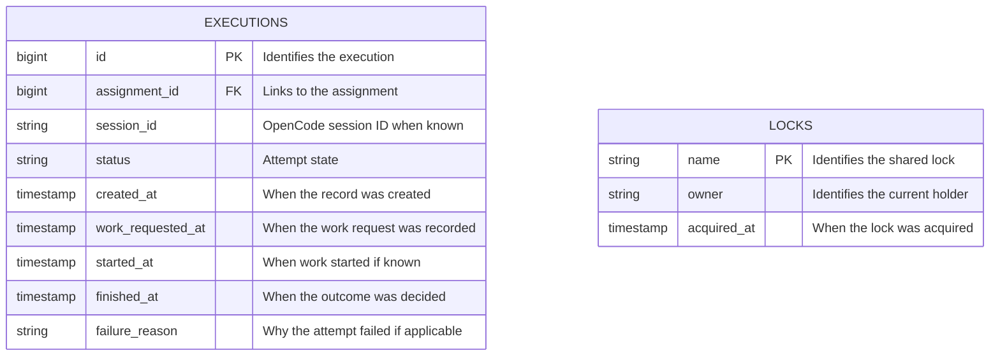

# Shared data reference

Estimated reading time: 2 minutes (150 WPM)

This is a scheduler-side copy of the approved models in the [Resource Manager data design](../../agent-resource-manager/docs/data.md). Both apps are intended to use the same SQLite database and shared tables. Someone must set up the database and all its tables; the Ticket Scheduler does not create or migrate them. See [setup](setup.md).

The current scheduler schema does **not** yet contain these tables or the planned agent URL. The models below are a design reference, not evidence that the database is ready. Types are illustrative, not an approved SQLite schema.

## Executions and locks

- `session_id`, `work_requested_at`, `started_at`, `finished_at`, and `failure_reason` can be empty.
- Execution statuses: `starting`, `running`, `succeeded`, and `failed`.
- An execution links to an assignment, which links to its ticket and agent. Count an attempt only when `work_requested_at` is recorded. The first attempt counts as 1.
- The planned agent data keeps numeric `agents.id` and adds the OpenCode server URL. The scheduler relies on the agent status stored in the table.
- A lock is acquired by atomically inserting its unique name and owner token, and released only when both match. A held lock means retry on a later tick. Potentially stale locks are left for human review.

See [open discussion](open-discussion.md) for scheduler decisions, [missing features](missing-features.md) for implementation work, and the Resource Manager data design for the full session-recovery and completion details.
